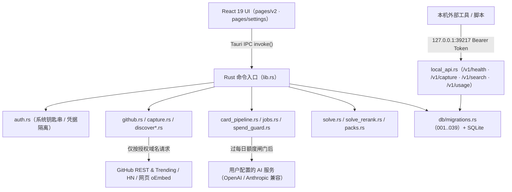

# Fox Stars Lab 代码与技术架构说明

> 本文档面向接手开发或贡献代码的工程师与 AI 协作者，准确描述 **`2.1.0-fox.1`** 现行代码组织、核心数据流与工程约束。

---

## 一、技术栈与 Monorepo 布局

- **桌面容器**：Tauri 2（Rust 后端 + 系统 WebView + macOS / 系统凭据库 + 原生打包）
- **前端界面**：React 19 + TypeScript 6 + Vite 8 + Tailwind CSS 4 + Radix UI + Lucide / Material Symbols
- **本地存储**：SQLite 3（`rusqlite`，版本化顺序迁移 `001–039`）
- **包管理与构建**：Node.js >= 24 + pnpm >= 11（仓库固定 `.corepack` 与 `tools/cards/run.sh` 验证入口）

```text
fox-stars-lab/
├── apps/
│   └── desktop/
│       ├── src/                    # React 19 前端应用
│       └── src-tauri/              # Rust Tauri 2 后端与原生构建配置
├── packages/
│   ├── ai/                         # @gsat/ai 共享 AI 抽象边界
│   ├── domain/                     # @gsat/domain 领域模型与前后端共享类型
│   ├── github/                     # @gsat/github GitHub 接口边界
│   ├── search/                     # @gsat/search 搜索 DSL 与查询结构
│   ├── storage/                    # @gsat/storage SQLite Schema 与 fox/001..039 迁移脚本
│   └── worker/                     # @gsat/worker 共享同步/任务辅助逻辑
├── docs/
│   ├── rebuild/spec/               # 编译器内嵌规格 JSON（禁止移动路径）
│   └── ...                         # 全景文档、发版日志与历史归档
└── tools/
    ├── cards/run.sh                # 统一构建与全套自动化测试入口
    ├── dev-ui/                     # Playwright 隔离端到端验收与 mock-host 调试工具
    └── fsl.mjs                     # 本地 HTTP API 开发期辅助命令行脚本
```

---

## 二、总体数据流与系统边界



### 运行时身份彻底隔离

| 环境 | Product Name | Bundle ID | 凭据服务名 | 说明 |
|---|---|---|---|---|
| 正式版 (`tauri.conf.json`) | `Fox Stars Lab` | `com.foxwork.fox-stars-lab` | `fox-stars-lab` | 用户真实数据库所在目录；调试构建不得使用 |
| 开发版 (`tauri.dev.conf.json`) | `Fox Stars Lab Dev` | `com.foxwork.fox-stars-lab.dev` | `fox-stars-lab-dev` | `pnpm dev:desktop` 启用；`dev_guard.rs` 在启动时强制检查防串库 |

---

## 三、前端代码地图（`apps/desktop/src/`）

| 路径 | 职责说明 |
|---|---|
| `App.tsx` · `lib/nav.ts` | 主导航壳（5 大核心业务入口 + 设置入口）、命令面板（`⌘K` / `/`）及跨页跳转问题消费 |
| `pages/v2/today.tsx` | 「今日」总览页：值得先看推荐、近期收藏分组、状态统计卡与快速详情联动 |
| `pages/v2/library.tsx` | 「资料库」页：多维筛选、键盘导航、会话状态保持（切换 Tab 不丢筛选与滚动） |
| `pages/v2/solve.tsx` | 「找方案」页：需求匹配、AI 精选切换、勾选主/备候选并生成三格式交接单 |
| `pages/v2/discover.tsx` | 「发现」页：热门趋势 5 路榜、自由搜索、按场景补缺三大模式 |
| `pages/v2/capture.tsx` | 「收集」页：文本抽链接预览、提交去重、网页摘要抓取与文章中 GitHub 项目提取 |
| `pages/settings/{index,shared,*-section}.tsx` | 单层 6 页签模块化设置（`github` / `ai` / `organize` / `backup` / `connect` / `general`） |
| `components/{kit,ui,library,solve,discover,capture,welcome}/` | 基础 UI 原子与业务展示组件（详情抽屉、候选卡、收集箱卡、首次欢迎引导等） |
| `lib/{contracts,api}.ts` | 前后端 IPC 返回结构契约与统一 `invoke` 包装、错误翻译 |
| `lib/{item-format,library-filters,library-session,solve-view,solve-draft,discover-view,capture-view,automation-view}.ts` | 与 React 解耦的纯视图状态、筛选规则与格式化逻辑（均配高覆盖 Vitest 单测） |
| `lib/codex-prompts.ts` · `lib/old-terms.test.ts` | 外部 AI 助手交接提示词模板；新界面禁用旧词的静态正则测试守卫 |
| `hooks/{use-list-keys,use-ai-automation,use-regenerate,use-repo-readme,...}.ts` | 列表键盘导航、自动整理轮询、单张重写与 README 缓存失效等复用 Hook |

> 说明：`apps/desktop/src/features/` 仍保留少量上游兼容组件文件；新界面逻辑统一位于 `pages/v2/`、`pages/settings/` 与 `lib/`。

---

## 四、Rust 后端模块地图（`apps/desktop/src-tauri/src/`）

| 分组 | 模块 | 核心职责 |
|---|---|---|
| **应用入口与隔离** | `main.rs` · `lib.rs` · `auth.rs` · `dev_guard.rs` | Tauri 生命周期与命令注册（`tauri::generate_handler!`）、钥匙串凭据读写（含不弹窗读取 `optional_github_token()`）、正式/开发目录防混检 |
| **数据库与备份** | `db/migrations.rs` · `db/mod.rs` · `storage.rs` · `backup.rs` | 顺序迁移 `001–039`（单事务执行 + 迁移前自动备份 + 完整性检查）、基础表读写、本机备份/安全恢复与全量导出 |
| **同步、收集与资料库** | `github.rs` · `capture.rs` · `inbox_fetch.rs` · `inbox_view.rs` · `library_view.rs` · `repo_facts.rs` · `readme_follow.rs` · `scenarios.rs` · `v2_ops.rs` | GitHub Stars/README 同步、线性 URL 抽取与安全检查（防内网/DNS 重绑定）、网页解压转码与摘要抽取、资料库筛选与维护状态计算、业务场景规则分类 |
| **AI 流水线与额度闸门** | `ai.rs` · `card_pipeline.rs` · `card_handler.rs` · `card_view.rs` · `jobs.rs` · `spend_guard.rs` | OpenAI / Anthropic 协议适配、README 分段截断与 `card-v3` 理解卡校验、后台队列认领、滚动 24 小时硬额度闸门与最近 50 次成功样本动态 token 估算 |
| **找方案与交接单** | `solve.rs` · `solve_rerank.rs` · `packs.rs` · `pack_guard.rs` · `local_scan.rs` | 动态规划中文分词与同义词打分、AI 精选单飞与断路器、三格式交接单（`fox-stars-lab.handoff/2`）及本机已有 Skill/MCP 只读扫描 |
| **发现榜单与热榜** | `discover.rs` · `discover_feeds.rs` · `rankings_live.rs` · `ranking_query.rs` · `community.rs` · `web_fetch.rs` | 场景缺口双轨检索（含近 90 天新锐保留配额）、GitHub Trending 线性无正则 HTML 解析 + Search API 兜底、7d/30d 新锐、HN Show 热门（限 GitHub 仓库）与自由搜索 |
| **本机 API 与预留向量模块** | `local_api.rs` · `embedding.rs` · `embedding_state.rs` · `vector_index.rs` | 127.0.0.1 HTTP 服务；本地 e5/zvec 向量检索底层能力（当前未挂入 V2 设置界面，见路线图 P1） |

---

## 五、数据库迁移与不可变契约

1. **只追加、不修改历史迁移**：
   - `packages/storage/migrations/fox/001–018_*.sql` 为 1.x 既有基线，**严禁改动**；
   - `019–039_*.sql` 为 2.0/2.1 追加迁移。`040_capture_sources_v2.sql` 增加原文、候选出处和投递去重记录。迁移登记在 `apps/desktop/src-tauri/src/db/migrations.rs` 的 `MIGRATIONS` 数组中，启动时核对版本号与名称，升级前自动生成 `.pre-migration-<ts>.sqlite3` 备份并校验 `PRAGMA integrity_check`。
2. **公共表与只读视图稳定性**：
   - `repositories`、`repo_ai_documents`、`repo_tags`、`annotations` 等核心列保持向后兼容，不改名、不删除；`029_public_views.sql` 提供的 `v_public_*` 只读视图供外部生态只读查询。
3. **编译期内嵌文件路径约束（`include_str!`）**：以下文件由 Rust 宏在编译期/测试期按相对路径直接嵌入，**禁止移动路径或删除**：
   - `docs/rebuild/spec/ai_card.schema.json`（`card_pipeline.rs`）
   - `docs/rebuild/spec/discover_queries.json`（`discover.rs`）
   - `docs/rebuild/spec/scenarios_seed.json`（`scenarios.rs`）
   - `docs/rebuild/spec/taxonomy_seed.json`（`v2_ops.rs`）
   - `docs/quality/embedding-golden.json`（`embedding.rs` 测试）

---

## 六、外部接口与自动化验收体系

### 1. 本机 HTTP API（`local_api.rs`，默认关闭）

- 仅监听 `127.0.0.1:39217`（拒绝任何非回环绑定、校验 `Host`、拒绝携带 `Origin` 头的浏览器请求、不返回 CORS 头、限并发与总读写超时）。
- 控制与密钥文件存放在应用数据目录下的 `fox-stars-lab.local-api.json`（`0600` 权限），支持两把独立 256 位 Bearer 令牌：
  - **完整令牌**：可访问 `GET /v1/health`、`GET /v1/search`、`POST /v1/capture`、`POST /v1/usage`；
  - **收集专用令牌**：仅允许 `POST /v1/capture` 投递进收集箱，其余受保护路由返回 `403`。

`POST /v1/capture` 默认使用 v1 的链接投递和计数响应。指定 `schemaVersion: 2` 时，`text` 是原文，`sourceUrl` 是可选的原文地址，`urls` 是可选的候选链接。至少提供一种内容。`sourcePlatform` 可指定 `x`、`feishu`、`douyin`、`xiaohongshu` 等，`sourceContext` 可提供来源备注。

下面的投递会返回 `sourceId`、`created` 和 `duplicateSubmission`，候选可以在收集箱确认。同一账号用同一 `idempotencyKey` 重试同一投递时，返回原来的 `sourceId`。同一编号提交不同内容会返回 `409`。

```json
{
  "schemaVersion": 2,
  "sourcePlatform": "x",
  "sourceUrl": "https://x.com/example/status/123",
  "text": "这一条收集了几个工作流。https://github.com/example/workflows",
  "idempotencyKey": "x-123"
}
```

### 2. 多层次自动化验收（`tools/cards/run.sh`）

- **Rust 格式与单元测试**：覆盖全部后端逻辑、迁移脚本与恶意结构解析夹具（1464+ 单测）。
- **前端构建与单元测试**：覆盖纯视图逻辑、状态切换、会话保持与 UI 文案静态守卫（945+ 单测）。
- **端到端隔离浏览器验收（`tools/dev-ui/acceptance.mjs`）**。生产构建接入确定性测试数据，覆盖窄窗口、深色模式、键盘操作、额度拦截、X 帖文补贴正文及跨来源去重等操作。
- **发布脚本故障演练（`tools/cards/release_test.py`）**：临时替身目录验证发版与预算闸门在缺失、断链、非整数或越界时必定中止。
