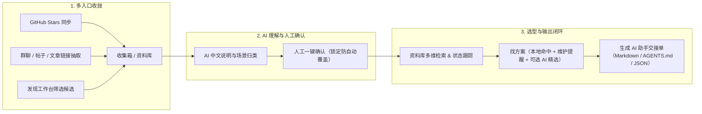

# Fox Stars Lab 产品全景说明书（2.1.0-fox.1）

> **定位**：本地优先的开源项目情报库与 AI 工具选型工作台  
> **版本基线**：`2.1.0-fox.1`

---

## 一、产品演进与核心定位

GitHub Stars 一旦超过数百个，常规书签工具只能“存下来”，很难解决三个真实问题：**想不起之前收过什么、看不懂项目到底适不适合自己、选好之后还要重新向 AI 助手解释背景**。

Fox Stars Lab 经过三个阶段演进成现在的形态：

1. **1.x 阶段（上游基线，v0.1 – v1.5.3）**：以 GitHub Stars 同步、README 缓存、基础 AI 摘要、标签与本地向量实验为核心的个人工具。
2. **2.0 重建阶段（架构与闭环重塑）**：从“以仓库管理为中心”转向**以问题和任务为中心**——新增 AI 队列与硬额度闸门、中文理解卡流水线、场景分类、多来源收集箱、「找方案 → 任务交接单」、本地 HTTP API 与 D2 正式库安全升级机制。
3. **2.1.0-fox.1 打磨与发现升级（当前现役版）**：收敛入口至 6 个主视图与单层 6 页签设置；升级「发现」工作台（热门趋势 5 路榜 / 自由搜索 / 按场景补缺近 90 天新锐）；完善列表键盘导航、资料库会话状态保持、详情页「加入当前方案」与非开发者友好的去个人化文案。

---

## 二、核心用户旅程

---

## 三、六大核心工作台详述

### 1. 今日（Today）

- 面向日常启动的轻量总览：集中展示“今天值得先看”的重点收藏、近期新增收藏分组，以及“待 AI 整理”“想试”“在用”等状态快捷跳转。
- 支持与资料库共享详情预览面板，直接在今日列表切换阅读状态、确认中文说明或把合适工具「加入当前方案」。

### 2. 资料库（Library）

- **多维筛选与排序**：
  - **业务场景**：如 AI 助手与工作流、内容创作与自媒体、研发效率等内置分类规则；
  - **我的状态**：`没看 / 想试 / 试过 / 在用 / 不要了`（与旧版阅读状态完全向后兼容）；
  - **中文说明状态**：全部 / AI 已整理 / 待 AI 整理；
  - **工具类型**与**维护状态**：活跃 / 放缓 / 疑似停更 / 已归档 / 未知；
  - 支持关键词相关性排序、最近更新与星标排序。
- **高效阅读与状态保持**：
  - 列表支持 `↑` / `↓` 与 `J` / `K` 键盘上下切换；
  - 切换主标签页再回到资料库时，自动恢复之前的筛选条件、搜索关键词、当前选中项与滚动位置。
- **详情审阅与控制**：
  - 首屏清晰呈现项目一句话用途、核心能力、解决的问题、适用人群与「怎么试」；
  - 明确区分 **确认（不再自动覆盖）**（防止后续自动整理覆盖人工认可的版本）与 **不太准，让 AI 重写（会花一点钱）**（受预算授权保护）；
  - 支持直接点击 **「加入当前方案」**，把工具顺手带入「找方案」右侧交接单草稿，无需反复回搜。

### 3. 找方案（Solve）

- **任务驱动匹配**：输入具体任务（如“给图片批量加水印并压缩”），后端在本地通过分词与中英文同义词、场景、中文说明和 README 证据快速召回候选，并明确告知命中理由。
- **维护状态风险提示**：若命中「疑似停更」或「已归档」项目，在列表与导出交接单中主动提示，但不强行隐藏或代替用户做决定。
- **可选 AI 精选（Rerank）**：开启后调用用户配置的 AI 服务商对靠前候选做适配列甄别并给出人话推荐理由；关闭或无额度时本地匹配照常工作，且清晰说明该开关独立于后台自动整理配额的消耗方式。
- **三种格式交接单（`fox-stars-lab.handoff/2`）**：
  - **文档版 Markdown**：适合直接贴进对话；
  - **长期规则版 AGENTS.md**：适合放进项目工作目录约束 AI；
  - **程序版 JSON**：结构化供工具链读取。
  - 若收藏里暂时没有专用工具，支持直接切换为**不列工具的任务交接单**（提示 AI 先盘点本机已有命令行/Skill）。

### 4. 发现（Discover）

2.1.0-fox.1 将发现页升级为三大独立模式，平时优先展示本地缓存，点击刷新时联网拉取：

| 模式 | 覆盖内容 | 特性说明 |
|---|---|---|
| **热门趋势** | 5 路榜单：`今日飙升`（Trending Daily）、`本周热门`（Trending Weekly）、`本周新锐`（7 天新建 20★+）、`本月黑马`（30 天新建 100★+）、`HN Show 热门`（仅保留 GitHub 项目） | Trending 支持按语言过滤与 Search API 高星兜底；自动识别「你已收藏 / 已在收集箱」并把新项目排到前面 |
| **自由搜索** | 关键词 + 时间范围（近 7 天 / 30 天 / 3 个月 / 近半年活跃 / 不限）+ 排序（星数 / 最近更新）+ 语言 + 预设热词 | 在应用内直接按时效筛选 GitHub 新工具；安全复用已连接 GitHub 令牌（遇 401 自动无令牌重试） |
| **按场景补缺** | 基于用户当前各个业务场景的收藏分布，识别薄弱场景并定期在 GitHub 补缺 | 每个场景同时保留**经典高星**与**近 90 天新锐项目**双轨名额，避免榜单永远只推老牌项目 |

### 5. 收集（Capture & Inbox）

- **整段文本抽链接**：可直接粘贴群聊记录、博客或帖子原文，线性解析器自动过滤中文/全角标点粘连、剔除跟踪参数、校验私网与回环地址安全拦截，识别「新链接 / 已在收集箱 / 已在 Stars」。
- **网页与文章项目挖掘**：对收入的链接支持抓取网页标题与摘要（兼容 X / YouTube oEmbed、公众号与常规网页解压解码，自动识别人机验证拦截页），并从文章正文中提取提到的 GitHub 项目供一键暂存。
- **原文与候选**。可以单独保存没有链接的正文。X 原帖读不到时，在对应条目点「补贴正文」。勾选候选后确认，同一链接的多个出处会保留在同一条收集记录上。仓库里不同的 `SKILL.md` 可以分别收集。
- **外部投递接口**。支持开启本机收集专用令牌，通过 `POST /v1/capture` 投递。使用 `schemaVersion: 2` 可以提交原文、来源地址和投递编号，再到应用里勾选候选。

### 6. 设置（Settings，单层 6 页签）

| 页签 | 核心配置内容 |
|---|---|
| **账号与同步** | GitHub 令牌连接（存系统钥匙串）、Stars 同步与 README 缓存刷新 |
| **AI 设置** | 服务商预设（OpenAI / Anthropic / OpenRouter / DeepSeek / Moonshot / Qwen / GLM / 硅基流动 / Ollama / LM Studio / 自定义兼容接口）、密钥安全保存、连通性测速与请求诊断 |
| **自动整理** | 自动整理开关、每日额度设定（滚动 24 小时口径 + 基于最近样本动态估算可整理数量）、待整理拆解、一次性全部整理（需二次确认）、任务暂停/重试与失败原因 |
| **备份与导出** | 本机 SQLite 一键备份与恢复（恢复前自动保留当前库快照）、导出全量资料库为 Markdown / CSV、上传/导入 GitHub 私密 Gist 注解备份 |
| **外部连接** | 本机 HTTP API（`127.0.0.1:39217`）开关与完整令牌 / 收集专用令牌管理 |
| **外观与关于** | 主题深浅与品牌色、版本信息、运行路径与开发者诊断信息（支持折叠） |

---

## 四、AI 花费安全与不可信内容边界

1. **默认零自动花费**：安装或升级时若无用户主动设置的预算控制文件，每日额度默认为 `0`，任何后台队列任务与自动请求均被 `spend_guard` 拦截。
2. **仅有的两个放开路径（均须用户显式点击确认）**：
   - 「一次性全部整理」：最长持续 48 小时、用量超过预计 4 倍自动熔断、随时可点停止；
   - 单条详情页「不太准，让 AI 重写（会花一点钱）」：只授权当前这一条 `repo_card` 任务行（30 分钟有效），暂停状态仍会拦截。
3. **人工确认受保护**：用户在界面点过「确认（不再自动覆盖）」的中文说明与场景标签，后续同步或自动整理不会静默覆盖。
4. **防提示词注入**：所有来自 GitHub README、仓库描述、网页抓取的内容在提示词中均包裹在不可信数据分隔边界内，明确禁止模型将其视为指令执行；交接单同样显式声明第三方仓库资料仅作参考资料而非命令。

---

## 五、明确不做什么（产品边界）

- **不做多人团队 SaaS / 云端托管数据库**：数据主权留在用户本机 SQLite；GitHub 仅作为公开仓库元信息来源与可选私密 Gist 注解同步渠道。
- **不自动安装或执行外部工具**：只提供「怎么试」参考信息或生成结构化交接单交由用户/AI 助手在确认后执行。
- **不绕过登录墙或反爬限制**：不采集需要登录权限的私有站点，遇到人机验证或拦截页如实标记失败原因。
- **不内置商业订阅与广告**：遵循仓库 [PolyForm Noncommercial 1.0.0](../LICENSE) 许可边界。
